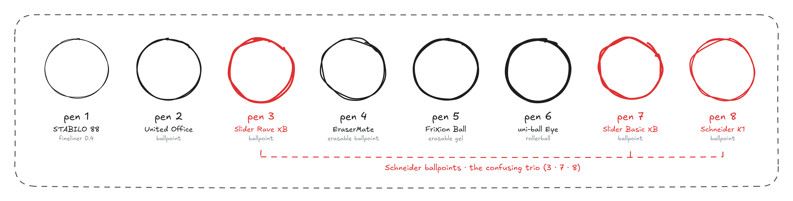
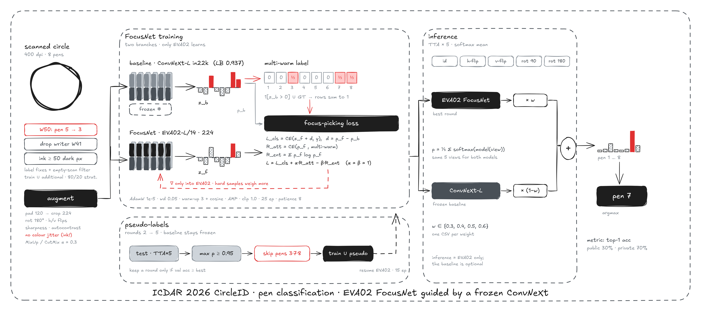

<div align="center">

# 🖊️ CircleID · Pen Classification

**Which of 8 black pens drew this circle? An EVA02-Large trained to focus on the pens a strong ConvNeXt confuses**

ICDAR 2026 competition track &nbsp;·&nbsp; [Kaggle competition ↗](https://www.kaggle.com/competitions/icdar-2026-circleid-pen-classification) &nbsp;·&nbsp; [challenge page ↗](https://thomasgorges.github.io/icdar2026-circleid/)


<br>


<br><em>the 8 pens. All are black ink, and three of them are Schneider ballpoints that look almost identical on paper</em>

</div>

---

## TL;DR

> One scanned circle, eight black pens. Most pens are easy. **Pens 3, 7 and 8** are three Schneider ballpoints, and they cause almost all the errors.
>
> - A **ConvNeXt-Large** (ImageNet-22k), fine-tuned on its own, already scores **0.937 on the public LB**. It is kept **frozen** and used as a *baseline branch*.
> - An **EVA02-Large/14** is trained as the *FocusNet branch* with the **focus-picking loss** of [FocusNet (Zhang et al., 2022)](https://arxiv.org/abs/2110.07307). For every image, the frozen ConvNeXt marks which pens it finds plausible (a **multi-warm label**). EVA02 is pushed to keep attention on exactly those pens, to weigh harder the samples where it is less sure than the baseline, and to avoid over-confidence.
> - **4 rounds of pseudo-labelling** add confident test predictions (p ≥ 0.95). The confusing pens 3/7/8 are **never** pseudo-labelled.
> - At inference, **5-view TTA** for both models, then a **weighted softmax blend** of EVA02 and ConvNeXt.

## Contents

1. [The task](#1--the-task)
2. [Solution at a glance](#2--solution-at-a-glance)
3. [Data cleaning](#3--data-cleaning)
4. [Augmentation: keep the ink intact](#4--augmentation-keep-the-ink-intact)
5. [FocusNet · learning from what the baseline confuses](#5--focusnet--learning-from-what-the-baseline-confuses)
6. [Pseudo-labelling](#6--pseudo-labelling)
7. [Inference · TTA + ensemble](#7--inference--tta--ensemble)
8. [Hyper-parameters](#8--hyper-parameters)
9. [Repository & how to run](#9--repository--how-to-run)
10. [Design notes](#10--design-notes)
11. [References](#11--references)

---

## 1 · The task

**CircleID** is an [ICDAR 2026](https://thomasgorges.github.io/icdar2026-circleid/) competition run by the Pattern Recognition Lab at FAU Erlangen-Nürnberg and the Book Studies group at JGU Mainz. Participants get **tightly cropped scans of hand-drawn circles**, digitised at **400 dpi** with one circle per image. The challenge has two tracks: *writer identification* and **pen classification** (this repo).

The pen track asks: *which pen drew this circle?* The test set mixes **writers seen in training and writers never seen**, so the model has to learn the **pen** (ink deposition, stroke width and texture) and not the **hand**.

| pen | model | type |
|:---:|---|---|
| 1 | STABILO point 88 fine 0.4 | fineliner |
| 2 | United Office | ballpoint |
| **3** | **Schneider Slider Rave XB** | **ballpoint** |
| 4 | Paper Mate EraserMate 1.0M | erasable ballpoint |
| 5 | PILOT FriXion Ball | erasable gel rollerball |
| 6 | uni-ball Eye UB-157 | rollerball |
| **7** | **Schneider Slider Basic XB** | **ballpoint** |
| **8** | **Schneider K1** | **ballpoint** |

<sub>Pen list from the organisers' competition report ([arXiv:2605.07816](https://arxiv.org/abs/2605.07816)).</sub>

| | |
|---|---|
| **Data** | 46,155 circle crops in total. `train.csv` (23,850), `additional_train.csv` (16,400, the former test set, includes unknown writers) and `test.csv` (5,905: 3,377 from known writers + 2,528 from unseen writers) |
| **Columns** | `image_id`, `image_path`, `writer_id`, `pen_id` |
| **Metric** | **Top-1 accuracy**. Macro-F1 is reported by the organisers for analysis only |
| **Leaderboard** | public = 30 % of test, private = 70 % |
| **Submission** | `image_id, pen_id` with one prediction for every test image |

The organisers' report confirms it: **pens 3, 7 and 8 are by far the most confused**, and most of the hardest samples are pens 3 and 7. A generic classifier treats all 8 classes the same. This solution spends its capacity on those three.

---

## 2 · Solution at a glance

<p align="center">
  
</p>
<p align="center"><sub>editable source: <a href="assets/pipeline.excalidraw"><code>assets/pipeline.excalidraw</code></a> (open it at <a href="https://excalidraw.com">excalidraw.com</a>)</sub></p>

| branch | backbone | role | trained? |
|---|---|---|---|
| **baseline** | `convnext_large.fb_in22k_ft_in1k` | produces the confusing-class signal (multi-warm labels + reference probabilities). 0.937 public LB on its own | ❄️ frozen |
| **FocusNet** | `eva02_large_patch14_224` | the model that is trained, with the focus-picking loss | ✅ full fine-tune |

Only EVA02 receives gradients. At test time you can run EVA02 **alone**, because the baseline adds no inference cost to the FocusNet itself. This repo also blends the two, since the frozen ConvNeXt is a strong model in its own right.

---

## 3 · Data cleaning

Three fixes run before any split:

| step | what | why |
|---|---|---|
| **label fix** | writer `W50`, `pen_id 5 → 3` | these samples are treated as mislabelled and relabelled to pen 3. Left as they were, they would teach a wrong pen-3/pen-5 boundary |
| **drop writer** | remove all `W41` samples | this writer's samples are excluded from training and validation as unreliable |
| **ink filter** | keep an image only if it has **≥ 50 pixels darker than 200** (grayscale) | removes blank or near-empty scans, which carry no pen signal and only add label noise |

After cleaning, `train` and `additional_train` are merged, and an **80/20 stratified split** on `pen_id` (seed 42) gives the validation set. The **same validation split** is used for every round, so accuracies across rounds are directly comparable.

---

## 4 · Augmentation: keep the ink intact

The signal is in **sub-millimetre stroke texture**: how the ink pools, skips and feathers. The augmentations change geometry freely but leave the ink's appearance alone.

```text
Pad(120, fill=white) → RandomCrop(224)          # circle lands anywhere, keeps native scale
RandomHorizontalFlip · RandomVerticalFlip · RandomRotation(180)
RandomAffine(translate=5%)
RandomAdjustSharpness(2, p=0.5) · RandomAutocontrast(p=0.3)
Normalize(ImageNet)
+ MixUp / CutMix (α = 0.3, 50/50 per batch)
```

- **No ColorJitter.** Brightness and saturation jitter wipe out exactly the ink-density cues that separate pens 3/7/8.
- **Sharpness and autocontrast** are kept: they change contrast without blurring stroke edges.
- **Padding with white, then cropping** (instead of resizing) keeps every image at its **native 400 dpi scale**. Stroke width in pixels is a real feature, and resizing would distort it.
- Circles have no natural orientation, so a **full 180° rotation** and both flips are free label-preserving augmentations.

---

## 5 · FocusNet · learning from what the baseline confuses

### 5.1 The idea

One-hot labels say *"pen 7, and every other pen is equally wrong."* That is false here: mistaking pen 7 for pen 3 (two Schneider ballpoints) is very different from mistaking it for pen 1 (a fineliner). [FocusNet](https://arxiv.org/abs/2110.07307) uses a pre-trained **baseline** to find *which* classes are confusing **for each image**, and trains a second network to **focus on separating the true class from those**.

### 5.2 Multi-warm label (Eq. 4–6)

For each image, the frozen ConvNeXt outputs logits $z^b$. Every class with a **positive logit** counts as confusing, the ground-truth class is always added, and the row is normalised:

$$
l'_n = \mathbb{1}[z^b_n > 0], \qquad
l''_n = \min\big(l'_n + \mathbb{1}[n = y],\ 1\big), \qquad
l_n = \frac{l''_n}{\sum_k l''_k}
$$

Example (true pen = 7, ConvNeXt positive on 3, 7, 8):

| pen | 1 | 2 | 3 | 4 | 5 | 6 | 7 | 8 |
|---|---|---|---|---|---|---|---|---|
| $z^b$ | −1.0 | −1.2 | **+2.1** | −0.4 | −1.5 | −0.9 | **+2.8** | **+0.6** |
| multi-warm $l$ | 0 | 0 | **⅓** | 0 | 0 | 0 | **⅓** | **⅓** |

<sub>reproduced by <code>python src/focus_loss.py</code></sub>

### 5.3 Focus-picking loss (Eq. 7–12)

With $p^f = \mathrm{softmax}(z^f)$ (EVA02) and $p^b = \mathrm{softmax}(z^b)$ (ConvNeXt):

$$
\mathcal{L} \;=\; \underbrace{\mathrm{CE}\big(z^f + d,\ y\big)}_{\mathcal{L}_{cls}}
\;+\; \alpha\,\underbrace{\mathrm{CE}\big(p^f,\ l\big)}_{\mathcal{R}_{att}}
\;-\; \beta\,\underbrace{\textstyle\sum_n p^f_n \log p^f_n}_{\mathcal{R}_{ent}},
\qquad d = \mathrm{sg}(p^f) - p^b, \quad \alpha = \beta = 1.
$$

| term | what it does | effect on pens 3/7/8 |
|---|---|---|
| $\mathcal{L}_{cls}$ | cross-entropy on logits **shifted by** $d$. When EVA02 is *less* confident than ConvNeXt on the true class, $d_y < 0$ and the loss grows | **hard samples weigh more**, so EVA02 can't coast on images the baseline already gets right |
| $\mathcal{R}_{att}$ | cross-entropy against the multi-warm label | keeps probability mass on the **confusing set**. EVA02 has to tell 3 from 7 from 8, not just push everything away from 1 |
| $-\mathcal{R}_{ent}$ | rewards entropy | blocks the over-confident, collapsed outputs that make ensembling and pseudo-label thresholds useless |

$\mathrm{sg}(\cdot)$ is stop-gradient: $d$ is a per-sample weight, not a path for gradients. The ConvNeXt forward runs under `torch.no_grad()`.

### 5.4 With MixUp / CutMix

Both branches see **the same mixed batch**, so the baseline's confusion signal matches what EVA02 sees. The loss is blended over the two label sets:

$$
\mathcal{L}_{mix} = \lambda\,\mathcal{L}(z^f, z^b, y_a) + (1-\lambda)\,\mathcal{L}(z^f, z^b, y_b)
$$

A clean, importable version of the loss lives in [`src/focus_loss.py`](src/focus_loss.py).

### 5.5 Why ConvNeXt as the baseline (and not EVA02 itself)

An earlier version used a first-round EVA02 as its own baseline. Swapping in the **0.937 ConvNeXt** made the multi-warm labels much **cleaner**. A stronger baseline marks fewer spurious classes as confusing, so $\mathcal{R}_{att}$ points at the *real* pen-3/7/8 ambiguity instead of noise. Using a different architecture (CNN vs. ViT) also gives the FocusNet a second view instead of a copy of its own mistakes.

---

## 6 · Pseudo-labelling

After round 1, rounds 2 → 5 repeat this loop:

1. Predict the test set with the current best EVA02 (**5-view TTA**).
2. Keep images with **max probability ≥ 0.95**.
3. **Drop every image predicted as pen 3, 7 or 8.** Even the best models are unreliable there, and a wrong pseudo-label on exactly those classes would undo what FocusNet is trying to learn.
4. Train on `train ∪ pseudo`, **resuming** from the current best EVA02, for 15 epochs (patience 5), still with the **same frozen ConvNeXt** baseline.
5. Validate on the **original, untouched** validation split. **Keep the round only if accuracy ≥ the best so far**. Otherwise keep the previous model and continue.

Because test contains **unseen writers**, pseudo-labels expose EVA02 to new hands on the easy pens. That is where generalisation to unseen writers comes from, at no labelling cost.

---

## 7 · Inference · TTA + ensemble

**TTA (5 views, both models):** identity, h-flip, v-flip, rot 90°, rot 180°, all from `Pad(120) → CenterCrop(224)`. Softmax probabilities are averaged over the views.

**Ensemble:** a weighted average of the two TTA'd probability vectors:

$$
p = w \cdot p_{\text{EVA02}} + (1 - w) \cdot p_{\text{ConvNeXt}}, \qquad \hat{y} = \arg\max_n p_n + 1
$$

The notebook writes one submission per setting so they can be compared on the public LB:

| file | content |
|---|---|
| `submission_eva02_focusnet.csv` | EVA02 FocusNet alone |
| `submission_ensemble_equal.csv` | 50 / 50 |
| `submission_eva3_cnxt7.csv` · `eva4_cnxt6` · `eva5_cnxt5` · `eva6_cnxt4` | $w$ = 0.3, 0.4, 0.5, 0.6 |

For each weight, the notebook also prints the share of pens 3 and 7 in the predictions. A blend that suddenly over-predicts one of the Schneider pens is a red flag, even before it is submitted.

---

## 8 · Hyper-parameters

| | value |
|---|---|
| input | 224 × 224, pad 120 (white), ImageNet mean/std |
| FocusNet | `eva02_large_patch14_224`, ImageNet-pretrained, full fine-tune |
| baseline | `convnext_large.fb_in22k_ft_in1k`, frozen, `channels_last` |
| optimiser | AdamW, lr **1e-5**, weight decay 0.05 |
| schedule | 3-epoch linear warm-up → cosine decay (per epoch) |
| batch / precision | 32, AMP (fp16 autocast + GradScaler), grad-clip 1.0 |
| round 1 | 25 epochs, early stopping patience 8 (val accuracy) |
| loss | focus-picking, α = 1, β = 1 |
| MixUp / CutMix | α = 0.3, MixUp or CutMix with p = 0.5 each |
| pseudo-labels | rounds 2–5, threshold 0.95, pens 3/7/8 excluded, 15 epochs, patience 5 |
| TTA | 5 views (id, h-flip, v-flip, rot 90, rot 180) |
| seed | 42 |

---

## 9 · Repository & how to run

```text
.
├── notebooks/
│   └── circleid_eva02_focusnet.ipynb   # full pipeline: clean → FocusNet → pseudo-labels → TTA → ensemble
├── src/
│   └── focus_loss.py                   # multi-warm label + focus-picking loss (stand-alone, self-test)
├── assets/
│   ├── pipeline.png / .excalidraw      # the diagram above (editable)
│   └── pens.png / .excalidraw          # header figure
├── requirements.txt
└── README.md
```

**Run on Kaggle (recommended):** one GPU with ≥ 24 GB, since EVA02-L and ConvNeXt-L sit on the GPU together during training.

1. Add the competition data and your ConvNeXt-L checkpoint as notebook inputs.
2. Set the paths in the first cell:
   ```python
   DATA_PATH              = "/kaggle/input/<competition-data>/"
   CONVNEXT_BASELINE_PATH = "/kaggle/input/<your-convnext>/large5.pth"   # dict with key 'model'
   ```
3. Run all cells. Checkpoints (`eva02_focusnet*.pth`), confusion matrices (`cm_*.png`) and the submission CSVs are written to the working directory.

**Locally:**

```bash
pip install -r requirements.txt
python src/focus_loss.py       # quick check of the loss: prints the multi-warm example above
jupyter lab notebooks/circleid_eva02_focusnet.ipynb
```

> The ConvNeXt-L baseline (`large5.pth`, 0.937 public LB) was fine-tuned in a separate notebook. Its weights are not included in this repo. Any 8-class `timm` ConvNeXt-L checkpoint saved as `{'model': state_dict}` will load.

---

## 10 · Design notes

- **Spend capacity where the errors are.** Seven pens out of eight are close to solved. The whole method (the FocusNet loss, the no-ColorJitter rule, the 3/7/8 exclusion from pseudo-labels) targets the Schneider trio.
- **The baseline is a teacher, not a target.** Unlike knowledge distillation, EVA02 is never asked to *copy* ConvNeXt's probabilities. It only gets told *which* pens to discriminate between, and *which* samples are hard.
- **Frozen ≠ useless at test time.** FocusNet needs only the FocusNet branch at inference, but a 0.937 ConvNeXt is too good to throw away. The blend weight is the one knob left to tune.
- **Guard every pseudo-label round.** Each round must beat the best validation accuracy on the same held-out split, or it is discarded.
- **Things to try next:** class-specific pseudo-label thresholds (lower for easy pens) instead of excluding 3/7/8 entirely; k-fold instead of a single split; higher input resolution (EVA02 at 448) to see more of the stroke texture.

---

## 11 · References

- X. Zhang, Z. Sheng, H.-L. Shen. **FocusNet: Classifying Better by Focusing on Confusing Classes.** *Pattern Recognition*, 2022. [arXiv:2110.07307](https://arxiv.org/abs/2110.07307) · [code](https://github.com/XueZ-phd/FocusNet-Classifying-better-by-focusing-on-confusing-classes)
- T. Gorges, J. van der Loop, L. Hüttner, L.-S. Schneider, F. Wu, M. Seuret, V. Christlein. **ICDAR 2026 Competition on Writer Identification and Pen Classification from Hand-Drawn Circles.** 2026. [arXiv:2605.07816](https://arxiv.org/abs/2605.07816) · [challenge page](https://thomasgorges.github.io/icdar2026-circleid/)
- Y. Fang et al. **EVA-02: A Visual Representation for Neon Genesis.** 2023. [arXiv:2303.11331](https://arxiv.org/abs/2303.11331)
- Z. Liu et al. **A ConvNet for the 2020s** (ConvNeXt). CVPR 2022. [arXiv:2201.03545](https://arxiv.org/abs/2201.03545)
- H. Zhang et al. **mixup: Beyond Empirical Risk Minimization.** ICLR 2018 · S. Yun et al. **CutMix.** ICCV 2019
- R. Wightman. **PyTorch Image Models (timm).** [github.com/huggingface/pytorch-image-models](https://github.com/huggingface/pytorch-image-models)

<div align="center"><sub>Mohamed Sadok Aissaoui · ENSTA Paris / École Polytechnique</sub></div>
